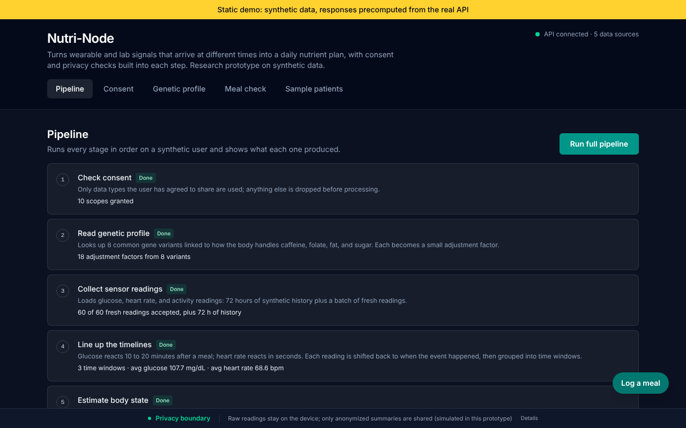

# Nutri-Node

[](https://github.com/deokhwajeong/BioAI-Nutrition/actions/workflows/ci.yml)


**Personalized nutrition from wearable and lab signals that do not arrive at the same time.**

A glucose spike shows up on a CGM 10 to 20 minutes after the meal that caused it; heart rate reacts in seconds; sleep is summarized once a day. Naively joining these streams by timestamp correlates the wrong events. Nutri-Node aligns them on a physiological clock first, then estimates metabolic state and a daily nutrient budget, with consent and differential privacy enforced inside the pipeline rather than bolted on.



> Educational and research prototype. Not a medical device and not medical advice. All data in this repository is synthetic.

## Quickstart

```bash
docker compose up --build        # API on :8000, web on :3000
```

Open http://localhost:3000 and press **Run Full Pipeline**. Interactive API docs are at http://localhost:8000/docs (send `X-API-Key: dev-api-key`).

Without Docker (needs [uv](https://docs.astral.sh/uv/) and pnpm):

```bash
make setup
make api      # terminal 1
make web      # terminal 2
```

## How it works

```mermaid
flowchart LR
    subgraph Sources
        CGM[CGM glucose]
        HR[Heart rate / HRV]
        ACT[Steps / exercise]
        SLP[Sleep]
        GEN[Genotype SNPs]
    end
    Sources --> C[0. Consent filter]
    C --> S[1. Temporal sync<br/>lag-compensated]
    S --> N[2. Normalization<br/>genotype-aware]
    N --> I[3. Circadian<br/>interpolation]
    I --> M[4. Metabolic state<br/>14-phase classifier]
    M --> B[5. Nutrient budget<br/>safety-first conflicts]
    B --> P[6. Differential<br/>privacy noise]
    P --> UI[Next.js dashboard]
```



| Stage | What it does | Code |
|---|---|---|
| Consent filter | Drops any signal whose scope the user has not granted, before it reaches computation | `app/privacy/consent_manager.py` |
| Temporal sync | Shifts each reading by `t_sync = t_event + Δt_base(b) × γ_genetic × φ_circadian`, then aligns into fine / medium / coarse frames | `app/engine/temporal_sync.py` |
| Normalization | Z-scores against personal, then genetic, then population baselines | `app/engine/normalization.py` |
| Interpolation | Fills sensor gaps from circadian and ultradian rhythm models, blending toward real data as it arrives | `app/engine/interpolation.py` |
| Metabolic state | Classifies 14 phases (fasting, post-prandial, exercise recovery, sleep, stress, ...) with intensities | `app/engine/metabolic_state.py` |
| Nutrient budget | Daily targets adjusted by phase and genotype; medical limits always win over genetic optimization, with an audit record | `app/engine/nutrient_calculator.py` |
| Privacy noise | Tiered ε budget per data sensitivity; only non-invertible embeddings leave the edge boundary | `app/privacy/` |

Deeper detail: [technical whitepaper](docs/whitepaper.md) · [user manual](docs/user-manual.md) · [provisional patent application](docs/patent/provisional-application.md).

## Repository layout

```
apps/api/        FastAPI service (uv, ruff, pytest)
  app/engine/      pipeline stages
  app/privacy/     consent, differential privacy, edge processing
  app/routers/     HTTP endpoints
  tests/           181 tests
apps/web/        Next.js 16 + React 19 dashboard
  lib/api.ts       typed client; lib/api-schema.d.ts is generated from the API's OpenAPI spec
rules/           YAML recommendation rules (non-diagnostic guardrails)
data/            synthetic Synthea FHIR fixtures
docs/            whitepaper, user manual, screenshots
```

## Engineering notes

- **One contract, enforced.** The web client's types are generated from FastAPI's OpenAPI spec (`make gen-api`). CI regenerates them and fails if they drift, so the frontend cannot silently fall out of sync with the API.
- **Checks on every push:** ruff lint and format, 181 API tests with coverage (77%), TypeScript strict typecheck, ESLint, production build, and both Docker images.
- **Security defaults:** every endpoint requires `X-API-Key`; strict Content-Security-Policy with same-origin API calls through Next.js rewrites; PII filter on all log records; pseudonymous user IDs hashed with a server-side pepper; CORS credentials only with explicit origins; dependency updates via Dependabot.
- **Runs anywhere:** SQLite by default (`DATABASE_URL` for Postgres); Celery tasks run inline unless `CELERY_BROKER_URL` is set; OCR is an optional extra (`uv sync --extra ocr`).

## Development

```bash
make check     # everything CI runs: lint, typecheck, tests, build
make test      # API tests with coverage
make format    # ruff fix + format
```

Configuration lives in environment variables; see [`.env.example`](.env.example).

## Status and roadmap

Working today: the full seven-stage pipeline end to end, consent management, medical-constraint overrides, meal text and image analysis, Synthea patient import, and the dashboard.

Next:
- Persist pipeline state in the database instead of in-process adapters
- Replace the shared demo API key with per-user auth behind a server-side proxy
- Validate lag parameters against the public OhioT1DM CGM dataset (loader in `app/services/ohio_t1dm_loader.py`)

## Author

Deokhwa Jeong · [LinkedIn](https://www.linkedin.com/in/deokhwa-jeong) · [GitHub](https://github.com/deokhwajeong)
