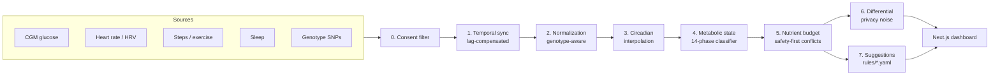

# Nutri-Node

[](https://github.com/deokhwajeong/BioAI-Nutrition/actions/workflows/ci.yml)


Nutri-Node is a research prototype that turns wearable and lab signals into a daily nutrient plan. The hard part is timing: a glucose monitor shows a meal 10 to 20 minutes after it happens, heart rate reacts in seconds, and sleep arrives once a day, so joining the streams by clock time pairs the wrong events. Nutri-Node shifts each signal by its expected delay first, then estimates the body's current state (fasting, after a meal, exercise recovery, sleep, and so on), sets daily nutrient targets in which medical limits always override genetic adjustments, and turns a logged day into plain suggestions using readable YAML rules. Consent checks and differential privacy run inside the pipeline. It is a FastAPI service plus a Next.js dashboard, runs on synthetic data only, and makes no clinical claims.


> Educational and research prototype. Not a medical device and not medical advice. All data in this repository is synthetic.

## Live demo

**[deokhwajeong.github.io/demos/nutri-node](https://deokhwajeong.github.io/demos/nutri-node/)** runs the real dashboard in the browser with no API server. Every response it shows was captured from this API running on the repository's synthetic data: the full pipeline run, the rule-based suggestions, all scored genotype combinations on the Genetic Profile tab, the meal analyzer's food table, the image analyzer's colour heuristics, and the five Synthea patients. Free-text meals and uploaded images are matched to the nearest precomputed result.

To rebuild it: `make demo` writes a static export to `apps/web/out/` (served under `/demos/nutri-node`). After engine changes, start the API from the repo root (`uv run --project apps/api uvicorn app.main:app --app-dir apps/api`) and run `make demo-fixtures` to recapture `apps/web/lib/demo-fixtures.json`.

## Quickstart

```bash
docker compose up --build        # API on :8000, web on :3000
```

Open http://localhost:3000 and press **Run full pipeline**. Interactive API docs are at http://localhost:8000/docs (send `X-API-Key: dev-api-key`).

Without Docker (needs [uv](https://docs.astral.sh/uv/) and pnpm):

```bash
make setup
make api      # terminal 1
make web      # terminal 2
```

## How it works



| Stage | What it does | Code |
|---|---|---|
| Consent filter | Drops any signal whose scope the user has not granted, before it reaches computation | `app/privacy/consent_manager.py` |
| Temporal sync | Shifts each reading by `t_sync = t_event + Δt_base(b) × γ_genetic × φ_circadian`, then aligns into fine / medium / coarse frames | `app/engine/temporal_sync.py` |
| Normalization | Z-scores against personal, then genetic, then population baselines | `app/engine/normalization.py` |
| Interpolation | Fills sensor gaps from circadian and ultradian rhythm models, blending toward real data as it arrives | `app/engine/interpolation.py` |
| Metabolic state | Classifies 14 phases (fasting, post-prandial, exercise recovery, sleep, stress, ...) with intensities | `app/engine/metabolic_state.py` |
| Nutrient budget | Daily targets adjusted by phase and genotype. Stacked adjustments are bounded (0.75x to 1.25x of base for energy, macros, and water; 0.5x to 2x for micronutrients) and protein is kept within 0.8 to 2.0 g/kg/day: the adult RDA (Institute of Medicine DRI, 2005) up to the top of the range for exercising adults (Jager et al., ISSN position stand on protein and exercise, JISSN 14:20, 2017). Medical limits are applied after these bounds and always win, with an audit record | `app/engine/nutrient_calculator.py` |
| Privacy noise | Tiered ε budget per data sensitivity; only non-invertible embeddings leave the edge boundary | `app/privacy/` |
| Suggestions | `POST /recommendations` evaluates the YAML rules in `rules/` against a logged day and the user's targets. Rules are validated at load (every condition must parse, every rule must carry the `non-diagnostic` guardrail) and conditions are parsed, never `eval`ed | `app/services/recommendations.py` |

## What is real vs simulated

| Real: computed by code in this repository | Simulated or synthetic |
|---|---|
| Consent gating, lag-compensated alignment, normalization, gap filling | Every sensor reading: 72 h of seeded synthetic data plus readings the dashboard generates |
| Metabolic state estimation (rule-based over aligned signals) and the nutrient target calculator, including medical-limit overrides and their audit trail | Genotypes, and the delay and genetic factors themselves: literature-inspired defaults, not yet validated on real CGM data (see roadmap) |
| Differential privacy mechanisms and per-sensitivity budgets | The "on-device" boundary: edge processing runs in the same server process to show what would stay local |
| YAML rule engine behind `/recommendations` | Synthea patients are fictional records from the open-source Synthea simulator |
| Meal text lookup against the built-in nutrition table | Food photos: colour-histogram heuristics (optional OCR), not a trained vision model |
| OpenAPI contract between API and web client | Meal check glucose curve: a simple in-browser model for illustration; lag view scatter dots are drawn to match the API's correlation value |
| | Static demo: responses captured from the real API, replayed in the browser |

No result here has been clinically validated, and nothing in the app is medical advice.

Deeper detail: [technical whitepaper](docs/whitepaper.md) · [user manual](docs/user-manual.md) · [provisional patent application](docs/patent/provisional-application.md).

## Repository layout

```
apps/api/        FastAPI service (uv, ruff, pytest)
  app/engine/      pipeline stages
  app/privacy/     consent, differential privacy, edge processing
  app/routers/     HTTP endpoints
  tests/           226 tests
apps/web/        Next.js 16 + React 19 dashboard
  lib/api.ts       typed client; lib/api-schema.d.ts is generated from the API's OpenAPI spec
rules/           YAML suggestion rules served by POST /recommendations
data/            synthetic Synthea FHIR fixtures
docs/            whitepaper, user manual, screenshots
```

## Engineering notes

- **One contract, enforced.** The web client's types are generated from FastAPI's OpenAPI spec (`make gen-api`). CI regenerates them and fails if they drift, so the frontend cannot silently fall out of sync with the API.
- **Checks on every push:** ruff lint and format, 226 API tests with coverage (79%), TypeScript strict typecheck, ESLint, production build, and both Docker images.
- **Security defaults:** every endpoint requires `X-API-Key`; strict Content-Security-Policy with same-origin API calls through Next.js rewrites; PII filter on all log records; pseudonymous user IDs hashed with a server-side pepper; CORS credentials only with explicit origins; dependency updates via Dependabot.
- **Runs anywhere:** SQLite by default (`DATABASE_URL` for Postgres); Celery tasks run inline unless `CELERY_BROKER_URL` is set; OCR is an optional extra (`uv sync --extra ocr`).

## Development

```bash
make check     # everything CI runs: lint, typecheck, tests, build
make test      # API tests with coverage
make format    # ruff fix + format
```

Configuration lives in environment variables; see [`.env.example`](.env.example).

## Status and roadmap

Working today: the full pipeline end to end, consent management, medical-constraint overrides, rule-based suggestions from `rules/`, meal text and image analysis, Synthea patient import, and the dashboard.

Next:
- Persist pipeline state in the database instead of in-process adapters
- Replace the shared demo API key with per-user auth behind a server-side proxy
- Validate lag parameters against the public OhioT1DM CGM dataset (loader in `app/services/ohio_t1dm_loader.py`)

## Author

Deokhwa Jeong · [LinkedIn](https://www.linkedin.com/in/deokhwa-jeong) · [GitHub](https://github.com/deokhwajeong)
